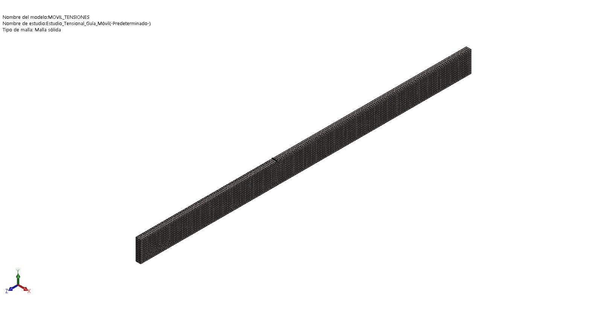
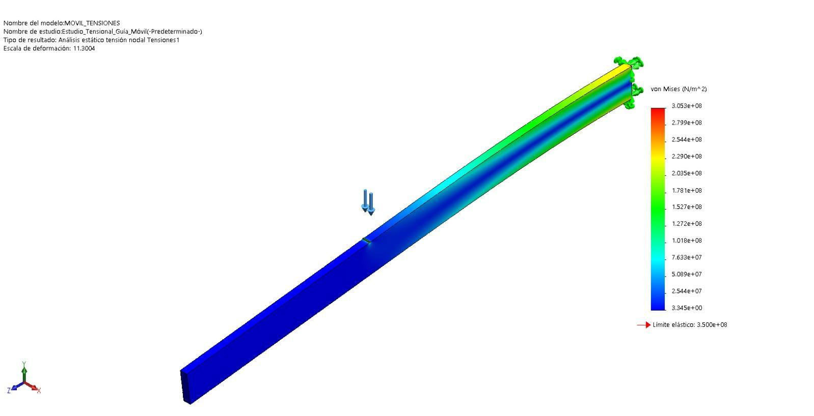
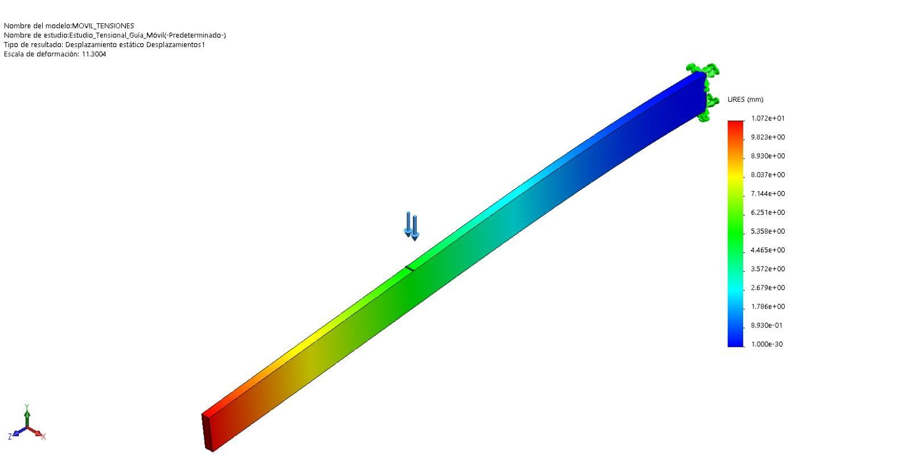
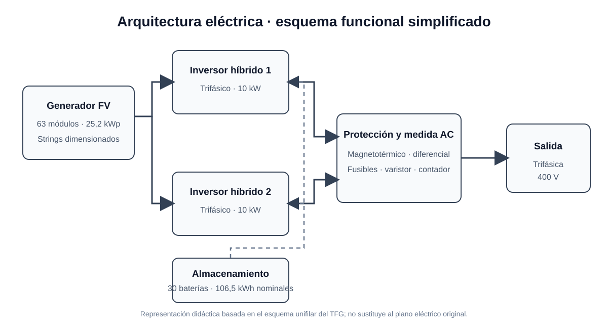

# Sistema móvil de generación fotovoltaica para transporte pesado

Diseño conceptual y desarrollo técnico de un generador solar móvil integrado en un semirremolque. El proyecto estudia cómo transportar una instalación fotovoltaica protegida por carretera y desplegarla en lugares con acceso limitado o inexistente a la red eléctrica.

> Trabajo Fin de Grado (Ingeniería Mecánica) — **Antonio Serrano Corral**

> **Documentación:** la memoria completa del TFG no se publica en este repositorio. Aquí se comparte una síntesis, imágenes propias del diseño y extractos representativos del análisis estructural y del esquema eléctrico; los planos y anexos completos pertenecen a la documentación académica.

## ¿Qué valor aporta?

En una emergencia, una obra aislada o una zona remota, disponer de energía suele implicar transportar y operar grupos electrógenos diésel. Este proyecto plantea una alternativa renovable y transportable: un semirremolque que lleva los paneles y el sistema eléctrico protegidos durante el viaje, y que se abre en destino para ampliar su superficie de captación.

La aportación principal es integrar en una misma solución el diseño mecánico desplegable y el dimensionado de una instalación fotovoltaica aislada. El trabajo recorre el proceso desde varias propuestas conceptuales hasta un modelo CAD detallado, estudia mecanismos hidráulicos y guías extensibles, considera las restricciones dimensionales del transporte y añade una evaluación económica preliminar. Así, sirve como caso de estudio de diseño mecánico, energía solar y análisis de viabilidad aplicado a una necesidad de suministro móvil.

## Propuesta técnica

- **Generador fotovoltaico:** 63 módulos de 400 W, para una potencia pico instalada de **25,2 kWp**.
- **Conversión:** dos inversores híbridos trifásicos de 10 kW.
- **Almacenamiento:** 30 baterías de litio de 3,55 kWh nominales cada una (**106,5 kWh nominales** en total).
- **Despliegue mecánico:** alas abatibles accionadas hidráulicamente, guías extensibles para separar los paneles y apoyos estabilizadores.
- **Uso previsto:** suministro temporal en emplazamientos aislados, con la orientación de los paneles ajustable según la ubicación.

Las cifras describen el diseño académico recogido en la memoria; no representan resultados de ensayos de un prototipo construido.

## Diseño y progreso

### 1. Exploración conceptual

Las alternativas iniciales exploran cómo aumentar la superficie fotovoltaica disponible manteniendo el conjunto compacto durante el transporte.

### 2. Integración en el semirremolque

El diseño CAD integra el bastidor, el vehículo tractor y el volumen que protege la instalación en carretera.

### 3. Configuración de transporte

Los paneles y mecanismos quedan plegados y protegidos antes de llegar al emplazamiento.

### 4. Secuencia de despliegue

En destino se estabiliza el conjunto y se abren progresivamente las alas y las superficies que alojan los paneles.

### 5. Configuración de generación

El modelo final muestra las guías extendidas y los paneles desplegados para captar energía solar.

*Las imágenes son figuras de elaboración propia incluidas en la memoria del TFG. El render representa el diseño; no documenta un equipo fabricado o probado.*

## Cálculo mecánico de las guías extensibles

La memoria estudia una de las guías que soportan los paneles mediante un análisis estático por elementos finitos. Las cargas se obtienen considerando el peso de los módulos y la acción del viento; se aplica una fuerza de **5.982 N** y se fija la guía en el extremo de apoyo. El modelo usa acero AISI 1020 y una malla sólida de **82.595 nodos** y **51.822 elementos**, con un tamaño aproximado de **5,93 mm**.

Para ese caso de carga, el informe obtiene una tensión de von Mises máxima de **305,3 MPa**, frente a un límite elástico de **350 MPa**, y un desplazamiento máximo de **10,72 mm**. Es una comprobación del modelo y las condiciones descritas en el TFG, no una validación experimental del conjunto completo.

El anexo identifica el software como **SOLIDWORKS Simulation**; no documenta un cálculo realizado en ANSYS.

  
  

## Dimensionado eléctrico y esquema unifilar

El anexo eléctrico dimensiona el conexionado de los paneles, las secciones de cable y las protecciones. Para seleccionar los conductores comprueba intensidad admisible, caída de tensión y cortocircuito. La memoria especifica **2,5 mm²** entre los strings fotovoltaicos y los inversores, y **6 mm²** entre los inversores y la caja de protecciones.

El siguiente esquema resume la arquitectura documentada: generador fotovoltaico, inversores híbridos, almacenamiento, protecciones y salida trifásica de 400 V.

*Esquema didáctico basado en el plano unifilar del TFG; no sustituye al plano eléctrico original ni constituye documentación de montaje.*

## Alcance del trabajo

1. Revisión de la generación fotovoltaica, los semirremolques y las soluciones móviles relacionadas.
2. Estudio del marco dimensional aplicable al transporte por carretera.
3. Diseño conceptual y selección de una configuración desplegable.
4. Dimensionado de módulos, inversores, baterías, cableado y protecciones.
5. Modelado del chasis y de los mecanismos de apertura y extensión en CAD.
6. Análisis estático por elementos finitos de las guías extensibles, mantenimiento y evaluación económica.

## Viabilidad económica: hipótesis del TFG

La memoria estima un presupuesto de **162.734,04 € con IVA** y plantea unos ingresos de **32.000 €/año** suponiendo una demanda continua del servicio (25 €/hora, ocho horas al día, cinco días por semana y ocho meses al año). Con esas hipótesis, el documento estima un plazo de rentabilidad de alrededor de seis años y un mantenimiento de 400 €/año.

Estas cantidades son estimaciones del estudio académico, basadas en precios y supuestos de su fecha de elaboración. No son una cotización actual ni una garantía de rentabilidad: el resultado depende, entre otros factores, de la demanda real y de las condiciones de operación.

## Estado y límites

Este repositorio presenta el diseño y los resultados documentados en el TFG. El trabajo concluye que la solución es viable mecánicamente a nivel de diseño, pero no acredita la fabricación, puesta en servicio ni validación experimental de un prototipo. La evaluación económica también depende de las hipótesis de demanda indicadas.

## Autoría

**Antonio Serrano Corral** — Trabajo Fin de Grado, Grado en Ingeniería Mecánica.

## Licencia y uso de las imágenes

No se ha asignado una licencia abierta a este material. Antes de reutilizar el diseño, las imágenes o el contenido, solicita autorización al autor.
