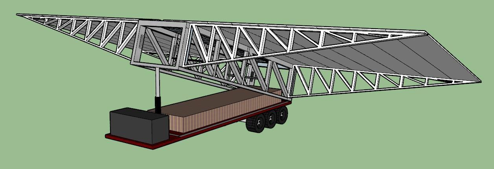
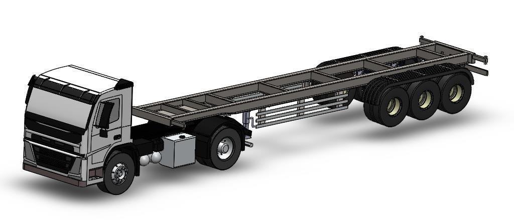
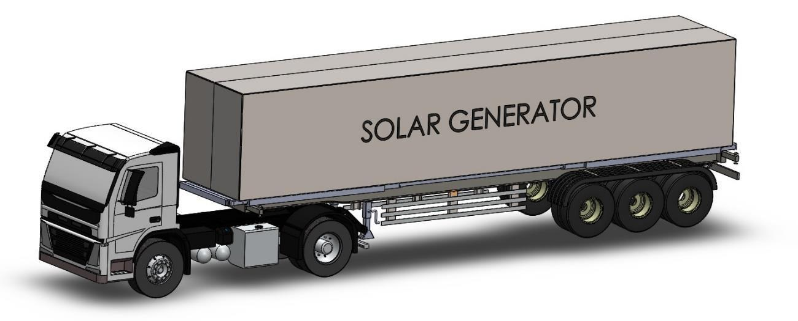
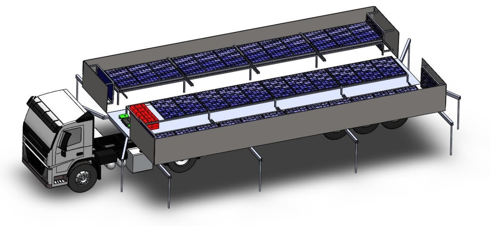
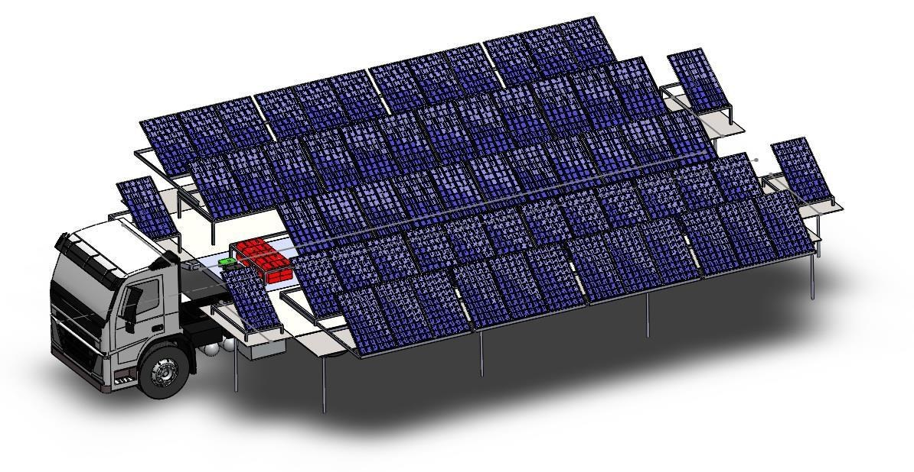
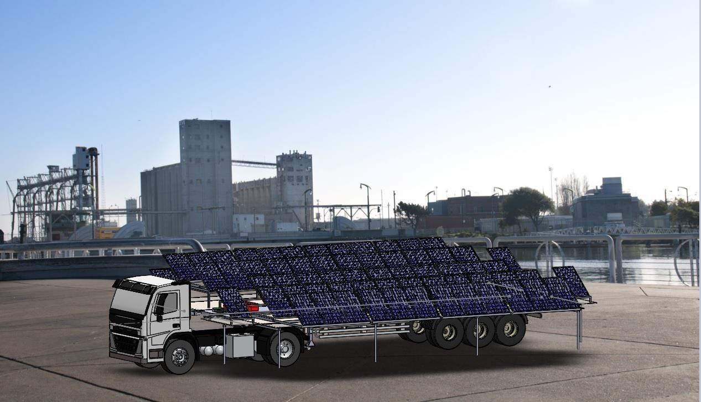
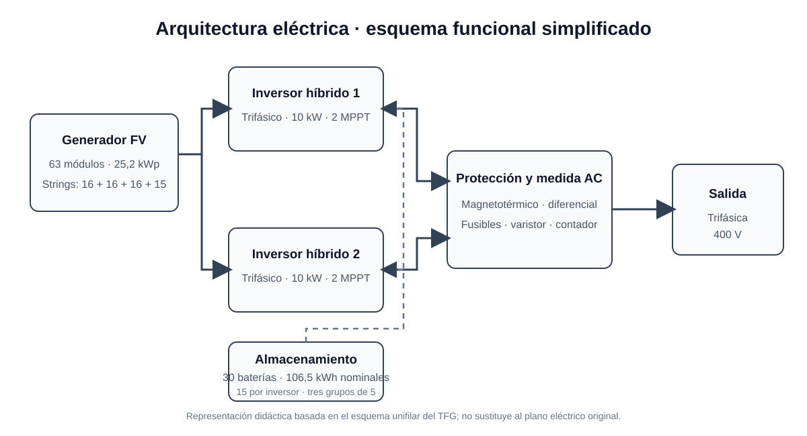

# Sistema móvil de generación fotovoltaica en vehículo de transporte pesado

Diseño conceptual y desarrollo técnico de un generador solar móvil integrado en un semirremolque. El proyecto estudia cómo transportar una instalación fotovoltaica protegida por carretera y desplegarla en lugares con acceso limitado o inexistente a la red eléctrica.

> Trabajo Fin de Grado (Ingeniería Mecánica) — **Antonio Serrano Corral**

> **Documentación:** la memoria completa del TFG no se publica en este repositorio. Aquí se presenta una síntesis del diseño y algunos extractos de sus cálculos. Los planos y anexos completos forman parte de la memoria académica.

## ¿Qué valor aporta?

El proyecto plantea una alternativa móvil de generación fotovoltaica para lugares sin acceso fácil a la red eléctrica, como emplazamientos temporales o zonas remotas. Los paneles y el sistema eléctrico viajan protegidos en un semirremolque que se despliega al llegar al destino.

La aportación del TFG es integrar el diseño mecánico de una estructura desplegable con el dimensionado eléctrico de una instalación fotovoltaica aislada. El trabajo abarca el desarrollo conceptual, el modelado CAD, el análisis de una guía extensible, la consideración de las dimensiones de transporte y un estudio preliminar de viabilidad económica.

## Propuesta técnica

- **Generador fotovoltaico:** 63 módulos de 400 W, para una potencia pico instalada de **25,2 kWp**.
- **Conexionado FV:** cuatro strings de **16, 16, 16 y 15 módulos**, conectados a los cuatro seguidores MPPT de dos inversores.
- **Conversión:** dos inversores híbridos trifásicos de 10 kW cada uno; salida prevista de 400 V trifásica.
- **Topología:** instalación aislada con acoplamiento en alterna (AC coupling), según el diseño de la memoria.
- **Almacenamiento:** 30 baterías de litio de 3,55 kWh nominales cada una (**106,5 kWh nominales** en total), 15 por inversor en tres grupos paralelos de cinco.
- **Despliegue mecánico:** alas abatibles accionadas hidráulicamente, guías extensibles para separar los paneles y apoyos estabilizadores.
- **Uso previsto:** suministro temporal en emplazamientos aislados, con posibilidad de ajustar la inclinación de los paneles.

Las cifras describen el diseño recogido en la memoria.

## Diseño y progreso

### 1. Exploración conceptual

Las alternativas iniciales exploran cómo aumentar la superficie fotovoltaica disponible manteniendo el conjunto compacto durante el transporte.

### 2. Integración en el semirremolque

El diseño CAD integra el bastidor, el vehículo tractor y el volumen que protege la instalación en carretera.

*La memoria indica que el modelo de la cabeza tractora se obtuvo de GrabCAD y se adaptó para el ensamblaje.*

### 3. Configuración de transporte

Los paneles y mecanismos quedan plegados y protegidos antes de llegar al emplazamiento.

### 4. Secuencia de despliegue

En destino se estabiliza el conjunto y se abren progresivamente las alas y las superficies que alojan los paneles.

### 5. Configuración de generación

El modelo final muestra las guías extendidas y los paneles desplegados para captar energía solar.

*Las imágenes muestran el diseño y los renders recogidos en la memoria; representan el modelo propuesto, no un equipo fabricado o probado.*

## Cálculo mecánico de las guías extensibles

La memoria estudia una de las guías que soportan los paneles mediante un análisis estático por elementos finitos. Se consideran el peso de los módulos y la acción del viento. El caso analizado aplica una carga de **5.982 N** sobre una guía de acero AISI 1020 con una cara fijada. La malla sólida contiene **82.595 nodos** y **51.822 elementos**, con un tamaño aproximado de **5,93 mm**.

Para ese caso de carga, el informe obtiene una tensión de von Mises máxima de **305,3 MPa**, frente a un límite elástico de **350 MPa**, y un desplazamiento máximo de **10,72 mm**. Es una comprobación del modelo y las condiciones descritas en el TFG, no una validación experimental del conjunto completo.

El análisis se realizó en **SOLIDWORKS Simulation**, según el anexo de resultados.

  
  

*La forma deformada de la imagen está representada con una escala visual ampliada; el desplazamiento máximo calculado es 10,72 mm.*

## Dimensionado eléctrico y esquema unifilar

El anexo eléctrico dimensiona el conexionado de los paneles, las secciones de cable y las protecciones. Para seleccionar los conductores comprueba intensidad admisible, caída de tensión y cortocircuito. La memoria especifica conductores de **2,5 mm²** entre los strings y los inversores, y de **6 mm²** entre los inversores y la caja de protecciones.

El siguiente esquema resume la arquitectura documentada: generador fotovoltaico, inversores híbridos, almacenamiento, protecciones y salida trifásica de 400 V.

*Esquema didáctico basado en el plano unifilar del TFG; no sustituye al plano eléctrico original ni constituye documentación de montaje.*

## Viabilidad económica: hipótesis del TFG

La memoria estima un presupuesto de **162.734,04 € con IVA** y plantea unos ingresos de **32.000 €/año** suponiendo una demanda continua del servicio (25 €/hora, ocho horas al día, cinco días por semana y ocho meses al año). Con esas hipótesis, el documento estima un plazo de rentabilidad de alrededor de seis años y un mantenimiento de 400 €/año.

Estas cantidades son estimaciones del estudio académico, basadas en precios y supuestos de su fecha de elaboración. No son una cotización actual ni una garantía de rentabilidad: el resultado depende, entre otros factores, de la demanda real y de las condiciones de operación.

## Licencia y uso de las imágenes

Este repositorio no concede una licencia abierta para el diseño ni para el contenido original del TFG. Algunas imágenes o modelos pueden incorporar recursos de terceros; consulta sus fuentes y licencias antes de reutilizarlos.
